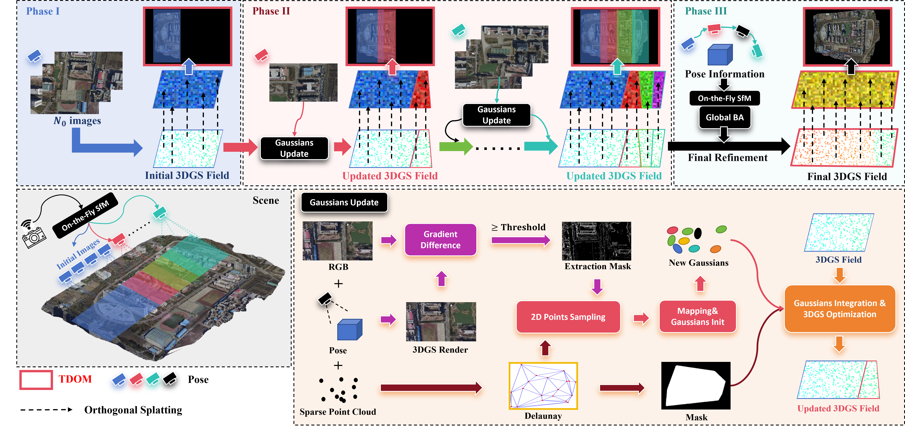

# Semantic A-TDOM

在 [A-TDOM](https://github.com/xywjohn/A-TDOM) 的渐进式 3D Gaussian Splatting 上融合多视角语义，生成 RGB TDOM 和 Semantic TDOM。
当前复现入口为 **Linux + NVIDIA CUDA** 下的 `tools/train_progressive.py`；输入为已经导出的渐进 SfM 快照、原始 RGB 和离线语义标签。



当前主开发分支为 **`semantic/g1-evidence-v2`**。训练期间持续维护高斯语义，默认直接复用在线状态生成最终地图；默认地图栅格只有 RGB 和语义彩色图。完整语义重投影、诊断栅格、过程视频和最终图像质量评估均有独立开关，见下文。

## 1. 仓库访问与克隆

本仓库为 **private**，同门需要先获得访问权限，无需为了共享而改成 public：

1. 仓库所有者在 GitHub 仓库的 **Settings → Collaborators → Add people** 中邀请同门的 GitHub 账号。
2. 同门接受邀请，并将自己的 SSH 公钥添加到自己的 GitHub 账号。
3. 使用自己的账号权限克隆指定分支：

```bash
git clone --branch semantic/g1-evidence-v2 git@github.com:xxxxzp/Semantic-ATDOM.git
cd Semantic-ATDOM
git rev-parse HEAD
```

也可以在配置好自己的 GitHub HTTPS 认证后使用：

```bash
git clone --branch semantic/g1-evidence-v2 https://github.com/xxxxzp/Semantic-ATDOM.git
cd Semantic-ATDOM
```

SSH key 只负责身份认证，不能代替仓库授权。遇到 `Repository not found` 时先检查是否已接受邀请、当前认证账号和分支名；遇到 `Permission denied (publickey)` 时检查 SSH key 配置。
详见 GitHub 的[邀请协作者](https://docs.github.com/en/repositories/managing-your-repositorys-settings-and-features/repository-access-and-collaboration/inviting-collaborators-to-a-personal-repository)和[配置 SSH key](https://docs.github.com/en/authentication/connecting-to-github-with-ssh/adding-a-new-ssh-key-to-your-github-account)说明。
个人账号仓库的协作者具有读写权限；若需要细分只读角色，可使用组织仓库，见[权限说明](https://docs.github.com/en/repositories/managing-your-repositorys-settings-and-features/repository-access-and-collaboration/permission-levels-for-a-personal-account-repository)。

三个 CUDA 扩展的源码已经提交在 `third_party/src/` 中，**没有需要初始化的 Git 子模块**。请使用本仓库版本的扩展，尤其是包含语义算子的 rasterizer。
数据、离线标签、训练结果和已编译的 `.so` 不包含在 clone 内容中，必须分别准备。需要复现实验时，向提供者取得同一份数据交付和代码 commit；分支名本身不是固定版本。

## 2. 安装 Linux 环境

已验证的核心组合如下；其他 GPU/系统组合需要自行验证：

| 项目 | 配置 |
|---|---|
| 系统 / GPU | Linux，NVIDIA RTX 4090（24 GB，计算能力 8.9） |
| Python | 3.10 |
| PyTorch / torchvision / torchaudio | 2.4.0 / 0.19.0 / 2.4.0 |
| CUDA Toolkit / PyTorch3D | 12.1 / 0.7.8 |
| NumPy / OpenCV / LPIPS | 1.26 / 4.10.0.84 / 0.1.4 |

需要 Conda、Git、可用的 NVIDIA 驱动和 C++ 编译器。驱动需支持所用 CUDA 版本；`nvidia-smi` 显示的 CUDA 版本不是 `nvcc` Toolkit 版本。
以下命令创建独立环境，在仓库根目录执行；不要在他人正在使用的共享环境中安装或覆盖扩展。

```bash
conda env create --file environment.yml
conda activate semantic-atdom
export PYTHONNOUSERSITE=1
export PYTHONDONTWRITEBYTECODE=1
export CUDA_HOME="$CONDA_PREFIX"
export PATH="$CUDA_HOME/bin:$PATH"
export TORCH_CUDA_ARCH_LIST="8.9"
export MAX_JOBS=4

nvcc --version
c++ --version

python -m pip install --no-build-isolation --no-deps third_party/src/diff-gaussian-rasterization
python -m pip install --no-build-isolation --no-deps third_party/src/simple-knn
python -m pip install --no-build-isolation --no-deps third_party/src/fused-ssim
python -m pip install --no-deps -e .
```

`TORCH_CUDA_ARCH_LIST=8.9` 仅针对 RTX 4090。更换 GPU 时按实际计算能力调整，在自己的环境中重新编译三个扩展。
环境名 `semantic-atdom` 已被占用时，用 `conda env create --name semantic-atdom-repro --file environment.yml` 创建新环境，并激活新名称。

需要过程视频时，PATH 中还必须能找到 **`ffmpeg` 和 `ffprobe`**，且 ffmpeg 支持 `libx264`。它们未列入 `environment.yml`；可通过系统包管理器安装，或在自己的新环境中执行 `conda install -c conda-forge ffmpeg`。

```bash
ffmpeg -version
ffprobe -version
ffmpeg -hide_banner -encoders | rg libx264
```

没有 `rg` 时，最后一行可改用 `grep libx264`。不生成视频则无需执行这一组检查。

### 选择 GPU 与检查安装

共享服务器上先确认空闲设备，优先通过 UUID 选择一张允许使用的 GPU。将下方占位符替换为实际 UUID；本项目本次验证使用物理 GPU 0，未使用物理 GPU 1。

```bash
nvidia-smi --query-gpu=index,uuid,name --format=csv
export CUDA_VISIBLE_DEVICES="GPU-替换为你获准使用的GPU的UUID"
python -c 'import torch; assert torch.cuda.is_available(); print(torch.__version__, torch.version.cuda, torch.cuda.get_device_name(0))'
python tools/train_progressive.py --help
```

只暴露一张卡后，训练参数 `--gpu 0` 表示该可见设备，而不是服务器上的物理 GPU 编号。
不要把 `--gpu 1` 当成选择另一张物理卡的通用方法。

## 3. 准备数据：RGB、渐进 SfM、语义交付

**训练不会从 RGB 自动生成 SfM 或语义标签。** 请先取得对应场景的完整数据交付；只有一个最终 COLMAP 模型也不足以复现渐进训练。
建议每个场景一个输入目录，实验结果存到输入目录之外：

```text
/path/to/data/phantom3/                         # 输入，只读
├── images/                                   # 原始 RGB
│   ├── 000001.jpg
│   └── ...
├── GaussianSplatting/                        # 渐进 SfM 阶段目录
│   ├── 14/
│   │   ├── bin/
│   │   │   ├── cameras.bin
│   │   │   ├── images.bin
│   │   │   └── points3D.bin
│   │   ├── match_matrix_image_name.txt
│   │   └── match_matrix_value.txt
│   ├── 15/
│   └── .../                                 # 完整实验到 414/
└── semantic_labels/                          # --semantic_data_root 指向这里
    └── semantic/
        ├── class_spec.json
        ├── labels/000001.png
        ├── metadata/000001.json
        └── ...

/path/to/experiments/Onthefly/phantom3/         # 输出，可写
```

- 每个被选中的阶段都需要完整的三份 COLMAP 二进制文件，以及影像名列表和匹配矩阵。兼容旧布局 `<stage>/sparse/0/`，其 overlap 文件为 `imagesNames.txt` 和 `imageMatchMatrix.txt`。
- 阶段编号在所选范围内必须连续。默认要求相机身份集合累积；初始化阶段必须包含 overlap 列表对应的完整相机，不能随便从一个只有局部相机的阶段冷启动。
- `--Image_Folder_Path` 显式指定共享原始 RGB 目录。其他交付可能使用 `*_CAM/`，按实际路径设置即可。
- 标签必须是与原始 RGB 同名、同尺寸、对齐的单通道 `uint8` 类别 ID PNG；ID 与 `class_spec.json` 一致。`ignore=255` 不等于背景类。当前 Semantic TDOM 最多支持 15 个真实类别。
- 每张标签需要配套 metadata，记录尺寸、类别规范、标签哈希和生成来源；新交付应包含原始 RGB 的 `source_image_sha256`。完整规范见[标签交付接口](docs/design/phantom3-semantic-label-contract-v1.md)，其中八类定义仅适用于对应 Phantom3 交付。
- 从其他原始 ID 标签转换时，可用 `python tools/prepare_id_labels.py --help` 查看参数。该工具需要显式 ID 映射规范，并写入一个新目录；它不执行语义分割，也不能恢复彩色预览中丢失的类别信息。`configs/semantic/` 中的映射属于特定 UAVScenes 交付，不能直接套用于任意场景。

RGB、SfM、原始标签和类别规范在训练期间保持只读。预检和缓存写入实验目录。不要把 `--Model_Path_Dir` 放到输入场景或语义交付目录内，也不要为了适配 `--resolution` 提前覆盖原图、缩放标签或修改 SfM 内参。

## 4. 完整训练示例

下面以已经验证过的数据布局 **Phantom3：1870×1049、阶段 14–414** 为例。先替换三个绝对路径；`ATDOM_OUTPUT` 必须在输入目录之外。
不同数据集还需设置自己的原始宽高、完整初始化阶段和最终阶段。`--StartFromImageNo` / `--EndAtImageNo` 是磁盘上的阶段编号。

```bash
ATDOM_DATA="/path/to/data/phantom3"
ATDOM_SEMANTICS="$ATDOM_DATA/semantic_labels"
ATDOM_OUTPUT="/path/to/experiments/Onthefly/phantom3"

python tools/train_progressive.py \
  --Source_Path_Dir "$ATDOM_DATA/GaussianSplatting" \
  --Image_Folder_Path "$ATDOM_DATA/images" \
  --semantic_data_root "$ATDOM_SEMANTICS" \
  --Model_Path_Dir "$ATDOM_OUTPUT" \
  --run_name phantom3-online-full \
  --OriginImageWidth 1870 \
  --OriginImageHeight 1049 \
  --StartFromImageNo 14 \
  --EndAtImageNo 414 \
  --resolution 1 \
  --gpu 0 \
  --IterationFirstScene 2000 \
  --IterationPerMergeScene 100 \
  --GlobalOptimizationInterval 1 \
  --GlobalOptimizationIteration 100 \
  --FinalOptimizationIterations 4000 \
  --points_per_triangle 8 \
  --GaussiansNumMax 1000000 \
  --GaussianBudgetSlack 0.05 \
  --LogMaskThreshold 0.1 \
  --enable_semantics \
  --render_TDOM \
  --semantic_tdom_render_tile_rows 256 \
  --GSD_x 0 \
  --GSD_y 0 \
  --NoDebug \
  --skip_final_evaluation
```

这组预算为初始化 2000 次、400 个增量阶段各 100 次局部优化加 100 次全局优化、最终 4000 次，共 **86000 次优化**。
不启用 `--Use_Tri_Mask`，与已记录的 Phantom3 完整实验设置一致。`--NoDebug` 跳过中间阶段质量评估；`--skip_final_evaluation` 跳过最终 PSNR/SSIM/VGG-LPIPS，不影响模型和地图交付。

运行前会自动预检阶段、相机、RGB、标签及其绑定。预检失败应修正路径或数据交付，不要删除哈希校验来绕过。
`--run_name` 会分配 `<ATDOM_OUTPUT>/runs/<名称>_<时间>_<commit>/`，每次运行生成独立目录；日志中会打印实际路径。

首次可以把结束阶段改为 `--EndAtImageNo 18`、运行名改为 `phantom3-smoke`，其余训练预算保留；这会走完初始化、增量、最终优化和地图发布，仅用于功能检查，不能替代完整结果对比。

### 分辨率和坐标

| 参数 | 含义 |
|---|---|
| `--resolution 1` | 原始宽高 |
| `--resolution 2` / `4` / `8` | 原始宽高除以对应因子，按实现取整 |
| `--resolution 1612` | 大于 8 的值表示目标宽度，按比例确定高度；4032×3024 → 1612×1209 |

使用原始 RGB、原始 SfM 和原始分辨率语义交付。代码依据原始标定进行去畸变和像素映射，再构造训练分辨率的相机与图像；类别 ID 和离散掩膜始终使用最近邻映射，禁止混合类别 ID 的双线性/双三次插值。
原始观测、去畸变网格和训练网格是显式区分的；这也不等于简单地把所有标签预先缩小一遍。坐标约定与验证见[降采样说明](docs/fix/2026-10-semantic-resolution-248.md)。

`--GSD_x 0 --GSD_y 0` 自动选择地图网格。非零值以当前 SfM 世界坐标单位计量；缺少尺度约束时不能直接当作米。GSD 越小，地图和导出成本通常越大，复现时应保留相同设置。

### 按需增加输出

向上面的训练命令追加相应参数：

| 需求 | 参数 |
|---|---|
| RGB / 语义同步过程视频 | `--render_training_progress --training_progress_target_frames 120 --training_progress_fps 4` |
| 最终全量语义重投影 | `--semantic_final_rebuild` |
| 整数类别 ID 图 | `--semantic_tdom_save_class_ids` |
| 未知区掩膜、原因及适用的补洞来源 | `--semantic_tdom_save_masks` |
| 证据支持度 / 语义熵 TIFF | `--semantic_tdom_save_evidence` / `--semantic_tdom_save_entropy` |
| 完整辅助栅格 / 概率数组 | `--semantic_tdom_save_diagnostics` / `--semantic_tdom_save_probabilities` |
| 保存最终优化器训练状态 | `--save_final_training_state` |
| 阶段边界恢复点 | `--recovery_checkpoint_every_stages 25`，会增加序列化耗时和磁盘占用 |

过程视频依赖 `--enable_semantics --render_TDOM` 和上述 ffmpeg 工具。默认只在最终发布地图，在线语义融合仍持续进行。
要进行最终图像质量评估，删除 `--skip_final_evaluation`；LPIPS 使用 VGG 权重，首次运行可能需要下载 torchvision 权重。逐相机渲染导出再追加 `--render_all_cameras`，它不能与 `--skip_final_evaluation` 共用。

默认最终语义状态为 `approx_final`：继承渐进语义，排空待处理任务、刷新活动组并校验输入后发布；已关闭历史观测没有全部按最终几何重算。
显式重建成功时为 `exact_final`，表示按最终几何重投影完整观测，并不表示语义真值准确率更高。它会额外读取标签、重投影和融合；详见 [ADR 0012](docs/decisions/0012-minimal-map-products-and-online-finalization.md)。

## 5. 查找地图、模型和运行记录

一次成功运行的主要目录如下，部分文件仅在对应选项开启时出现：

```text
<ATDOM_OUTPUT>/runs/<run_id>/
├── manifest.json                         # 状态、代码版本、命令、产物索引
├── model/
│   ├── gaussians.ply
│   ├── cameras.json
│   └── semantic/                         # 语义状态、schema、最终策略记录
├── products/maps/
│   ├── latest.json                       # 指向同一次发布的地图对
│   └── releases/<product_key>/
│       ├── pair_manifest.json
│       ├── rgb/tdom.png
│       └── semantic/semantic_color.png
├── videos/training_progress.mp4          # 开启过程视频时
├── metrics/                              # timing.json、summary.json 等
├── provenance/                           # config.json、dataset_preflight.json 等
└── logs/                                 # 训练日志及可能的 failure.txt
```

两张地图旁还保留小型类别、调色板及对齐/完整性清单；默认不会输出类别 ID、掩膜或 TIFF。训练过程缓存位于 `<run>/.work/`，成功收尾后按保留策略清理。
不要从旧运行目录随便各取一张图配对，应通过 `products/maps/latest.json` 选择同一次发布。

可以用以下只读命令检查退出状态和最终地图文件，替换实际运行目录：

```bash
ATDOM_RUN="/path/to/experiments/Onthefly/phantom3/runs/实际的run_id"
python - "$ATDOM_RUN" <<'PY'
import json
import sys
from pathlib import Path

run = Path(sys.argv[1])
manifest = json.loads((run / "manifest.json").read_text())
assert manifest["status"] == "succeeded", manifest
maps = run / "products/maps"
pointer = json.loads((maps / "latest.json").read_text())
pair_path = maps / pointer["pair_manifest"]
pair = json.loads(pair_path.read_text())
print("semantic_status:", pair["semantic_status"])
for relative in ("rgb/tdom.png", "semantic/semantic_color.png"):
    path = pair_path.parent / relative
    assert path.is_file(), path
    print(path)
PY
```

`metrics/timing.json` 记录逐阶段几何、在线总耗时及语义提交等分项；初始化阶段通常包含多帧，相机新增加数量也可能不同，不能简单将每个阶段都当作单帧。
只比较相同代码版本、数据哈希、阶段范围、分辨率、训练预算、GSD、GPU，以及视频/评估/重建选项下的结果。

## 6. 环境记录与已验证范围

安装后可记录版本、扩展二进制位置、CUDA 能力和语义算子，并运行已有测试：

```bash
mkdir -p ../semantic-atdom-repro-records
python tools/capture_environment.py ../semantic-atdom-repro-records/environment.json
conda list --explicit > ../semantic-atdom-repro-records/conda-explicit.txt
python -m pip freeze > ../semantic-atdom-repro-records/pip-freeze.txt
python -m unittest discover -s tests
```

检查环境记录中 `extensions.semantic_cuda_symbols` 的 `semantic_observation`、`semantic_tdom`、`semantic_tdom_tile` 均为 `true`；否则可能装成了其他版本的 rasterizer。
测试不需要实验数据；CUDA 测试需要上文选定的 GPU 和本地扩展。没有可用 CUDA 时会跳过相关测试，不能把这种运行视为 GPU 验收。
`environment.yml` 固定核心版本，部分依赖仍由 Conda 求解；并非所有平台都能得到逐字节相同的环境。复现实验请同时保存 commit、环境记录、输入交付哈希和运行目录中的配置/预检记录；CUDA 训练结果也不保证逐字节一致。

截至 2026-10-21，本次合并代码的验证范围为：

- 269 项测试在物理 GPU 0 全部通过，无跳过。
- 原始 Phantom3 的阶段 14–18、18 个累计相机、每条 6800 次优化，在线复用和显式重建两条路径通过；状态重载、地图校验及开启视频的路径解码通过。
- 固定最终像素输入的导出回放中，精简辅助文件后，两张必要 PNG 与原始产物 SHA256 完全一致。
- 更早的性能优化版本已完成 Phantom3 414 视角和 XinCao 完整实验；**新默认在线最终策略尚未重跑 414 视角完整训练，也未完成同一最终模型下两种策略的严格耗时与质量对照**。

记录见[当前默认策略验收](docs/exp/semantic-minimal-online-final-2026-10-21.md)和[此前完整性能实验](docs/exp/semantic-pipeline-full-2026-10-21.md)。这些记录包含提供者机器上的绝对路径，仅作为实验出处，不是同门机器上需要照搬的路径。
上述是已有环境中的验收，不等于已经在另一台全新机器上执行过本 README 的完整安装流程。

## 7. 常见问题与更多文档

| 现象 | 检查方式 |
|---|---|
| 找不到 `semantic_atdom` | 激活正确环境，在仓库根目录执行 `python -m pip install --no-deps -e .` |
| CUDA 扩展无法导入或缺少语义算子 | 检查 PyTorch / Toolkit / GPU 架构及环境记录；在自己的环境内从本仓库源码重编译 |
| 语义预检失败 | 检查完整初始化阶段、连续阶段、overlap 文件、RGB/标签尺寸、ID 映射及 metadata 哈希 |
| 地图显存或导出成本过高 | 先检查 GSD 与最终地图尺寸；使用分条渲染，按需降低训练分辨率，保留相同设置再做对照 |
| 进程失败但目录中已有模型 | 以 `manifest.json` 状态为准，查看 `logs/failure.txt`；模型存在不代表地图/视频交付成功 |

- [语义证据如何赋予高斯](docs/design/semantic-evidence-assignment-rationale.md)
- [Semantic TDOM / G1 Evidence V2 设计契约](docs/design/semantic-tdom-v1.md)，默认导出和最终策略以 ADR 0012 的修订为准
- [异步视频与标签准备复用](docs/decisions/0011-ordered-progress-capture-and-label-reuse.md)
- [历史 Windows GUI、On-the-Fly SfM 导出及原始 README](docs/project/historical-readme.md)；当前 Linux 语义流程的验证不代表 Windows GUI 已支持相同参数

## A-TDOM 引用与来源

原始 A-TDOM 作者：Yiwei Xu, Xiang Wang, Yifei Yu, Wentian Gan, Luca Morelli, Giulio Perda, Xin Wang, Zongqian Zhan, Fabio Remondino。
[上游仓库](https://github.com/xywjohn/A-TDOM) · [论文](https://arxiv.org/abs/2509.12759)。本仓库内第三方依赖遵循各自目录中的许可证。

```bibtex
@article{xu2026tdom,
  title={A-TDOM: Active TDOM via on-the-fly 3DGS},
  author={Xu, Yiwei and Wang, Xiang and Yu, Yifei and Gan, Wentian and Morelli, Luca and Perda, Giulio and Wang, Xin and Zhan, Zongqian and Remondino, Fabio},
  journal={International Journal of Computer Vision},
  volume={134},
  number={8},
  pages={370},
  year={2026},
  publisher={Springer}
}
```
